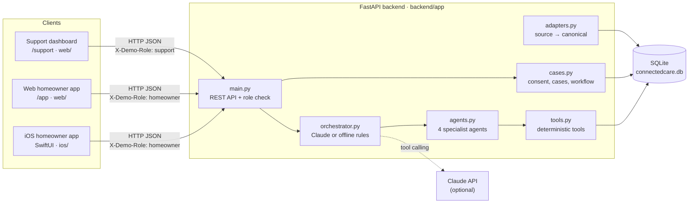
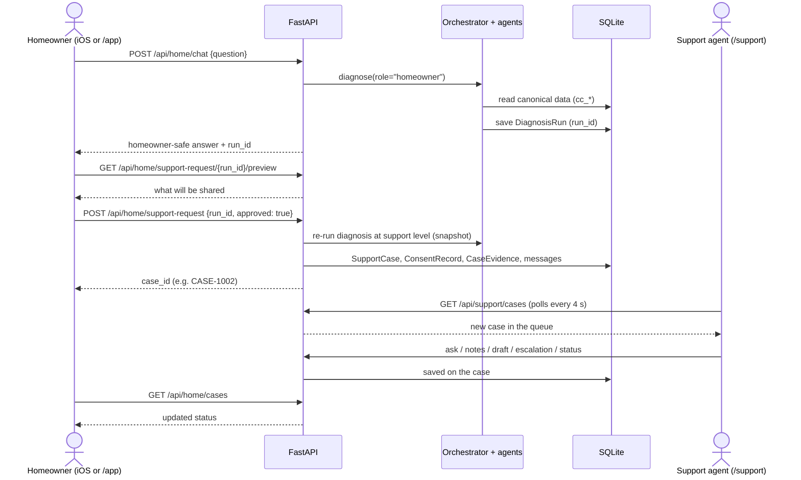
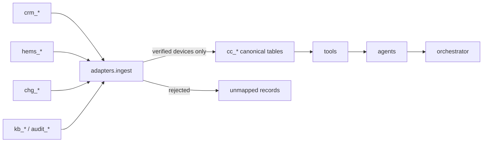

# ConnectedCare AI: technical documentation

How the homeowner app (iOS and web) and the support dashboard (web) connect through one backend. All data is synthetic.

## 1. System overview



There is **one backend and one database**. The apps never talk to each other directly. They connect through shared records: a support case created in the homeowner app is a row in `cc_support_cases`, which the dashboard reads.

| Part | Tech | Location | Talks to |
|---|---|---|---|
| iOS homeowner app | SwiftUI, iOS 16+, URLSession async/await | `ios/ConnectedCare/` | `/api/home/*`, `/api/demo/*` |
| Web homeowner app | React page (same features as iOS) | `web/src/pages/HomeApp.tsx`, served at `/app` | `/api/home/*`, `/api/demo/*` |
| Support dashboard | React 18, TypeScript, Vite, Tailwind, Recharts | `web/src/pages/Queue.tsx`, `Investigation.tsx` | `/api/support/*`, `/api/demo/*` |
| Backend | Python, FastAPI, SQLAlchemy 2, Pydantic 2 | `backend/app/` | SQLite, Claude API |
| Database | SQLite, one file | `backend/connectedcare.db` | — |

## 2. How the clients reach the backend

| Client | Base URL | How it is set |
|---|---|---|
| Web (production build) | same origin, e.g. `http://localhost:8000` | FastAPI serves `web/dist` and sends every unknown path to `index.html` |
| Web (dev, `npm run dev`) | `http://localhost:5173` | Vite proxies `/api` to `http://localhost:8000` (`web/vite.config.ts`) |
| iOS simulator | `http://localhost:8000` | default in `APIClient.defaultBaseURL` |
| iPhone on Wi-Fi | `http://<Mac Wi-Fi IP>:8000` | in the app: Demo → Server settings (saved with `@AppStorage`) |

Requirements for the iPhone:
- Start the backend with `--host 0.0.0.0`, so it accepts connections from other devices on the network.
- `Info.plist` allows plain HTTP on the local network (`NSAppTransportSecurity`) and explains local network access (`NSLocalNetworkUsageDescription`).
- CORS is open (`allow_origins=["*"]`) because this is a demo.

All requests and responses are JSON with `snake_case` keys. The iOS app converts them with `JSONDecoder.keyDecodingStrategy = .convertFromSnakeCase`.

## 3. Roles and what each one can see

There is no real login. Each request names its role in the `X-Demo-Role` header, and the **server** decides what to return.

| Role | Used by | Evidence it can see (`visibility.py`) |
|---|---|---|
| `homeowner` | iOS app, `/app` | `homeowner_safe` only |
| `support` | `/support` dashboard | `homeowner_safe`, `support_internal`, `restricted` |
| `partner` | escalation package to Voltara | `homeowner_safe`, `support_internal` |

- `/api/home/*` **always** runs as homeowner, whatever header is sent.
- `/api/support/*` returns `403` unless `X-Demo-Role: support` is sent.
- In Claude mode, the model only receives the filtered homeowner view when it answers a homeowner, and an answer that mentions internal detail is rejected.

> **Production note:** replace the demo header with real authentication (e.g. OAuth/OIDC, with the role taken from the token). The visibility filter in `visibility.py` stays the same.

## 4. API reference

Base path `/api`. Interactive docs: `http://localhost:8000/docs` (FastAPI/OpenAPI).

### Demo

| Method | Path | Body | Returns |
|---|---|---|---|
| GET | `/demo` | — | active scenario, scenario list, `ai_mode` (`claude`/`offline`), model |
| POST | `/demo/scenario` | `{"scenario": "A" \| "B" \| "C"}` | the new scenario |

### Homeowner (`X-Demo-Role: homeowner`)

| Method | Path | Body | Returns |
|---|---|---|---|
| GET | `/home/overview` | — | first name, EV battery %, reserve %, car-to-home status, charger, home load |
| POST | `/home/chat` | `{"question": "..."}` (2–500 chars) | `run_id`, `headline`, `what_happened`, `why[]`, `unknown[]`, `next_steps[]`, `support_recommended`, `evidence[]` (homeowner-safe) |
| GET | `/home/support-request/{run_id}/preview` | — | summary and the exact evidence list that would be shared |
| POST | `/home/support-request` | `{"run_id": "...", "approved": true, "note": "..."}` | `case_id`, `status`, `title`. Returns `400` if `approved` is not `true` |
| GET | `/home/cases` | — | the homeowner's cases and their current status |

### Support (`X-Demo-Role: support`)

| Method | Path | Body | Returns |
|---|---|---|---|
| GET | `/support/cases` | — | case queue |
| GET | `/support/cases/{id}` | — | case, customer, installation, devices, previous interactions, messages, consent, diagnosis, escalation |
| POST | `/support/cases/{id}/ask` | `{"question": "..."}` | copilot answer, agents used, evidence IDs |
| POST | `/support/cases/{id}/notes` | `{"text": "..."}` | saved internal note |
| POST | `/support/cases/{id}/draft-response` | — | customer reply draft (homeowner-safe facts only) |
| POST | `/support/cases/{id}/escalation` | — | partner package (no restricted records for external partners) |
| PATCH | `/support/cases/{id}/status` | `{"status": "New" \| "Investigating" \| "Escalated" \| "Resolved"}` | updated case |
| POST | `/support/diagnose` | `{"question": "..."}` | full support-level diagnosis without a case |
| GET | `/support/data-model` | — | sources, canonical entities, device mappings, transforms, rejected matches |

Errors: `400` invalid input or missing consent, `403` wrong role, `404` unknown case or run, `422` body failed validation.

## 5. The app-to-dashboard flow



Key points:
- **Consent is required.** No case is created unless the homeowner approves on the preview screen. The approval is stored as a `ConsentRecord` with the evidence IDs that were shared.
- **Snapshot at handoff.** The case keeps a support-level copy of the diagnosis (`snapshot_json`). If the demo scenario is later switched, the case still shows what was true when it was opened.
- **Near-real-time, by polling.** The dashboard polls the queue every 4 seconds. There are no websockets or push notifications.
- **What flows back to the homeowner:** the case status. Notes, copilot answers and escalations stay internal. The draft reply is shown to support for sending, but is not delivered into the app.

## 6. Backend internals

| Module | Responsibility |
|---|---|
| `main.py` | Routes, role check, request validation, serves the built web app |
| `sources.py` | The four simulated source systems, each with its own schema (`crm_`, `hems_`, `chg_`, `kb_`/`audit_` tables) |
| `seed.py` | Synthetic data: customer, devices and scenarios A/B/C |
| `adapters.py` | Converts source records into the canonical model: units to kW, sign convention (+ draws, − supplies the home), times to UTC, device identity checked via commissioning records and serial numbers |
| `canonical.py` | Unified data model (`cc_` tables) |
| `tools.py` | Deterministic tools the agents call (device status, sessions, schedules, SOC history, config changes, KB search…) |
| `agents.py` | Technical Diagnostics, Energy Behaviour, Security Correlation, Support Resolution |
| `orchestrator.py` | Picks the agents, combines findings into facts / interpretation / missing info / actions / evidence / escalation |
| `llm.py` | Claude mode: agents exposed as tools, validated structured output, falls back to offline on any error |
| `cases.py` | Consent preview, case creation, copilot follow-ups, notes, draft, escalation, status |
| `visibility.py` | Role → visibility levels |
| `datamodel.py` | Data model view and the homeowner overview |
| `state.py`, `db.py` | Active scenario, DB setup and reset |

### Data pipeline



Every canonical record keeps `source_system` and `source_record_id`, and becomes evidence with an ID such as `EVD-HEMS-hc_90017`. Answers can only cite evidence IDs that an agent actually returned.

### Database

One SQLite file with 37 tables. They're grouped by prefix: `crm_`, `hems_`, `chg_`, `kb_`/`audit_` (simulated sources) and `cc_` (ConnectedCare's own model and workflow).

## 7. Configuration

| Variable | Default | Effect |
|---|---|---|
| `CONNECTEDCARE_RESET` | unset | `1` wipes and reseeds the database at startup |
| `CONNECTEDCARE_DB_URL` | `sqlite:///backend/connectedcare.db` | any SQLAlchemy URL, e.g. Postgres |
| `ANTHROPIC_API_KEY` | unset | turns on Claude mode |
| `CONNECTEDCARE_OFFLINE` | unset | `1` forces offline mode even when a key is set |
| `CONNECTEDCARE_MODEL` | `claude-opus-5-5` | Claude model |
| `CONNECTEDCARE_EFFORT` | `low` | Claude effort level |

## 8. Running and testing

```bash
cd connectedcare/backend && .venv/bin/uvicorn app.main:app --host 0.0.0.0 --port 8000
cd connectedcare/web && npm run build          # served at :8000/support and :8000/app
cd connectedcare/backend && .venv/bin/python -m pytest -q   # 19 tests
cd connectedcare/web && npm run typecheck
```

iOS: open `ios/ConnectedCare.xcodeproj` in Xcode 15+ (see the README for iPhone setup).

## 9. Limits of the demo, and the path to production

| Demo choice | Production replacement |
|---|---|
| `X-Demo-Role` header | OAuth/OIDC sign-in; role and tenant from the token |
| SQLite, one file | Postgres with tenant isolation |
| Simulated sources seeded locally | Real connectors to CRM, HEMS cloud and the charger partner API |
| HTTP on the local network | HTTPS with a hosted backend; remove the ATS exception in `Info.plist` |
| Dashboard polls every 4 s | Websockets or server-sent events; push notifications to the iOS app |
| Draft reply not delivered to the app | Send endpoint that adds a homeowner-visible message to the case |
| One customer, one OEM | Multi-tenant OEMs and installer access |
