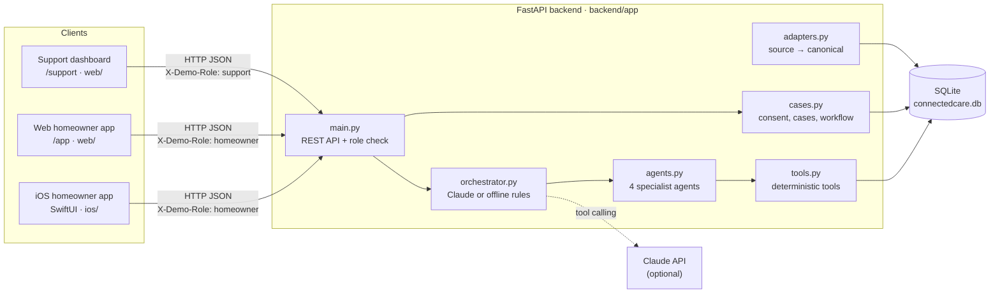
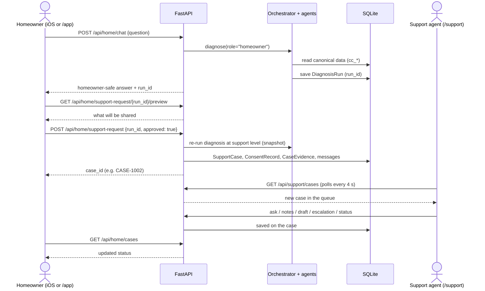
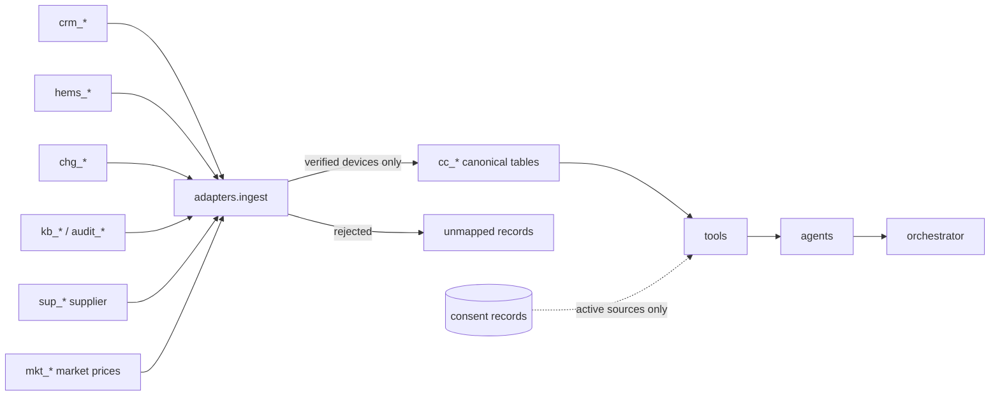
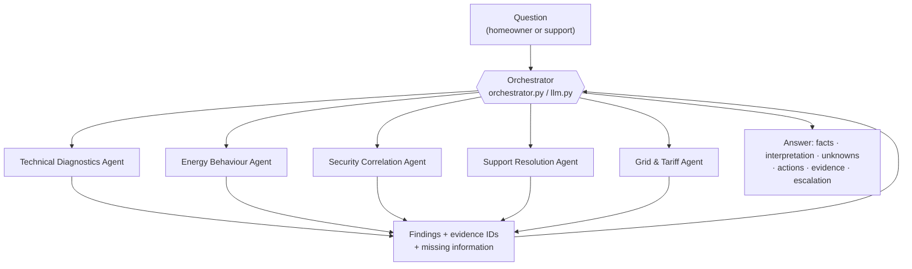
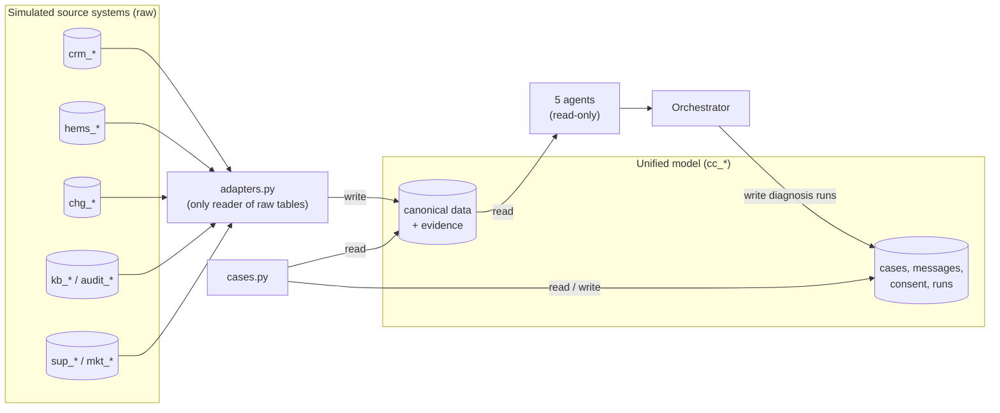
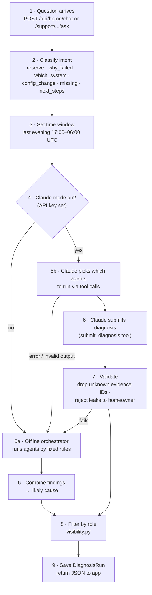
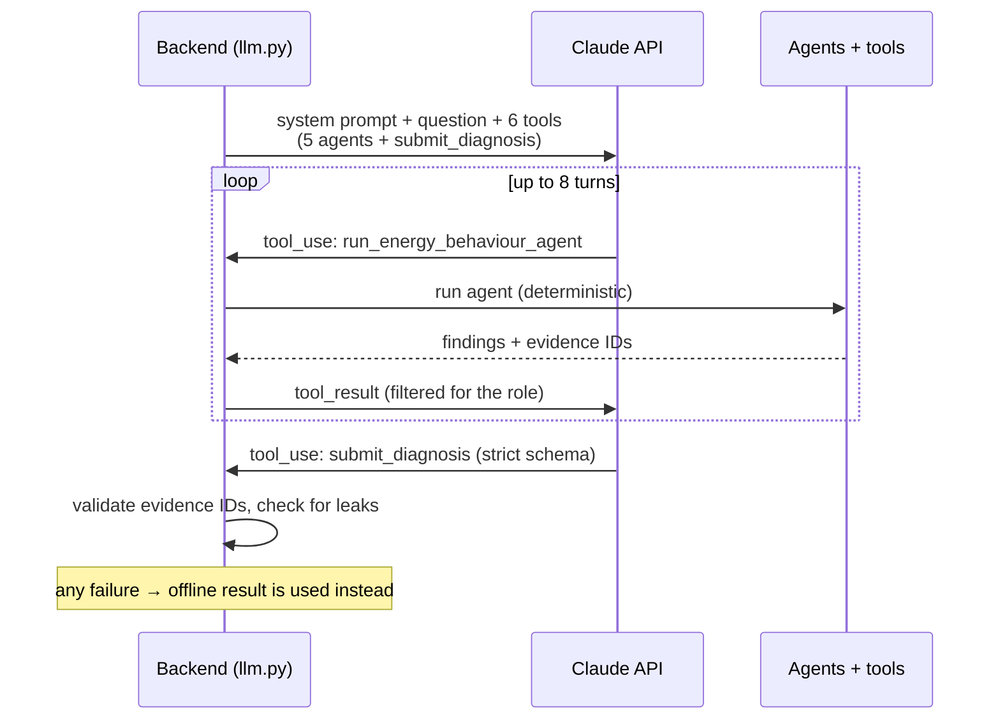

# ConnectedCare AI: technical documentation

How the homeowner app (iOS and web) and the support dashboard (web) connect through one backend. All data is synthetic.

## 1. System overview



There is **one backend and one database**. The apps never talk to each other directly. They connect through shared records: a support case created in the homeowner app is a row in `cc_support_cases`, which the dashboard reads.

| Part | Tech | Location | Talks to |
|---|---|---|---|
| iOS homeowner app | SwiftUI, iOS 16+, URLSession async/await | `ios/ConnectedCare/` | `/api/home/*`, `/api/demo/*` |
| Web homeowner app | React page (same features as iOS) | `web/src/pages/HomeApp.tsx`, served at `/app` | `/api/home/*`, `/api/demo/*` |
| Support dashboard | React 18, TypeScript, Vite, Tailwind, Recharts | `web/src/pages/Queue.tsx`, `Investigation.tsx` | `/api/support/*`, `/api/demo/*` |
| Backend | Python, FastAPI, SQLAlchemy 2, Pydantic 2 | `backend/app/` | SQLite, Claude API |
| Database | SQLite, one file | `backend/connectedcare.db` | — |

## 2. How the clients reach the backend

| Client | Base URL | How it is set |
|---|---|---|
| Web (production build) | same origin, e.g. `http://localhost:8000` | FastAPI serves `web/dist` and sends every unknown path to `index.html` |
| Web (dev, `npm run dev`) | `http://localhost:5173` | Vite proxies `/api` to `http://localhost:8000` (`web/vite.config.ts`) |
| iOS simulator | `http://localhost:8000` | default in `APIClient.defaultBaseURL` |
| iPhone on Wi-Fi | `http://<Mac Wi-Fi IP>:8000` | in the app: Demo → Server settings (saved with `@AppStorage`) |

Requirements for the iPhone:
- Start the backend with `--host 0.0.0.0`, so it accepts connections from other devices on the network.
- `Info.plist` allows plain HTTP on the local network (`NSAppTransportSecurity`) and explains local network access (`NSLocalNetworkUsageDescription`).
- CORS is open (`allow_origins=["*"]`) because this is a demo.

All requests and responses are JSON with `snake_case` keys. The iOS app converts them with `JSONDecoder.keyDecodingStrategy = .convertFromSnakeCase`.

## 3. Roles and what each one can see

There is no real login. Each request names its role in the `X-Demo-Role` header, and the **server** decides what to return.

| Role | Used by | Evidence it can see (`visibility.py`) |
|---|---|---|
| `homeowner` | iOS app, `/app` | `homeowner_safe` only |
| `support` | `/support` dashboard | `homeowner_safe`, `support_internal`, `restricted` |
| `partner` | escalation package to Voltara | `homeowner_safe`, `support_internal` |

- `/api/home/*` **always** runs as homeowner, whatever header is sent.
- `/api/support/*` returns `403` unless `X-Demo-Role: support` is sent.
- In Claude mode, the model only receives the filtered homeowner view when it answers a homeowner, and an answer that mentions internal detail is rejected.

> **Production note:** replace the demo header with real authentication (e.g. OAuth/OIDC, with the role taken from the token). The visibility filter in `visibility.py` stays the same.

## 4. API reference

Base path `/api`. Interactive docs: `http://localhost:8000/docs` (FastAPI/OpenAPI). They are switched off in demo mode (section 10).

### Demo

| Method | Path | Body | Returns |
|---|---|---|---|
| GET | `/demo` | — | active scenario, scenario list, `ai_mode` (`claude`/`offline`), model (hidden in demo mode), `demo_mode` |
| POST | `/demo/scenario` | `{"scenario": "A" \| "B" \| "C" \| "D" \| "E"}` | the new scenario |

### Homeowner (`X-Demo-Role: homeowner`)

| Method | Path | Body | Returns |
|---|---|---|---|
| GET | `/home/overview` | — | first name, EV battery %, reserve %, car-to-home status, charger, home load |
| POST | `/home/chat` | `{"question": "..."}` (2–500 chars) | `run_id`, `headline`, `what_happened`, `why[]`, `unknown[]`, `next_steps[]`, `support_recommended`, `evidence[]` (homeowner-safe) |
| GET | `/home/support-request/{run_id}/preview` | — | summary and the exact evidence list that would be shared |
| POST | `/home/support-request` | `{"run_id": "...", "approved": true, "note": "..."}` | `case_id`, `status`, `title`. Returns `400` if `approved` is not `true` |
| GET | `/home/cases` | — | the homeowner's cases and their current status |
| GET | `/home/savings?window=7d` | `window` = `7d` or `1d` | Savings card: contract type, € paid, € cheapest possible, € saving, per-session cheapest hours, tip, and `price_night`: hourly market and all-in prices from plug-in to departure, with the hours charged and the cheapest hours marked (shown as a price chart in the app) |
| GET | `/home/consents` | — | Data & privacy list: one row per source with `active`, `legal_basis`, `scope`, `expires_at`, `revoked_at` |
| POST | `/home/consents` | `{"source_system": "charger_integration"}` | grants (or returns the active) consent for that source |
| POST | `/home/consents/{consent_id}/revoke` | — | revokes it; tools then report the source as unavailable |

### Support (`X-Demo-Role: support`)

| Method | Path | Body | Returns |
|---|---|---|---|
| GET | `/support/cases` | — | case queue |
| GET | `/support/cases/{id}` | — | case, customer, installation, devices, previous interactions, messages, case-share consent, `data_consents` (which sources the homeowner consents to), diagnosis, escalation |
| POST | `/support/cases/{id}/ask` | `{"question": "..."}` | copilot answer, agents used, evidence IDs |
| POST | `/support/cases/{id}/notes` | `{"text": "..."}` | saved internal note |
| POST | `/support/cases/{id}/draft-response` | — | customer reply draft (homeowner-safe facts only) |
| POST | `/support/cases/{id}/escalation` | — | partner package (no restricted records for external partners) |
| PATCH | `/support/cases/{id}/status` | `{"status": "New" \| "Investigating" \| "Escalated" \| "Resolved"}` | updated case |
| POST | `/support/diagnose` | `{"question": "..."}` | full support-level diagnosis without a case |
| GET | `/support/data-model` | — | sources, canonical entities, device mappings, transforms, rejected matches (`404` in demo mode) |

Errors: `400` invalid input or missing consent, `403` wrong role, `404` unknown case or run, `422` body failed validation.

## 5. The app-to-dashboard flow



Key points:
- **Consent is required.** No case is created unless the homeowner approves on the preview screen. The approval is stored as a `ConsentRecord` with the evidence IDs that were shared.
- **Snapshot at handoff.** The case keeps a support-level copy of the diagnosis (`snapshot_json`). If the demo scenario is later switched, the case still shows what was true when it was opened.
- **Near-real-time, by polling.** The dashboard polls the queue every 4 seconds. There are no websockets or push notifications.
- **What flows back to the homeowner:** the case status. Notes, copilot answers and escalations stay internal. The draft reply is shown to support for sending, but is not delivered into the app.

## 6. Backend internals

| Module | Responsibility |
|---|---|
| `main.py` | Routes, role check, request validation, serves the built web app |
| `sources.py` | The six simulated source systems, each with its own schema (`crm_`, `hems_`, `chg_`, `kb_`/`audit_`, `sup_`, `mkt_` tables) |
| `seed.py` | Synthetic data: customer, devices (incl. a home battery), a week of hourly prices, scenarios A–E |
| `adapters.py` | Converts source records into the canonical model: units to kW, sign convention (+ draws, − supplies the home), times to UTC, device identity checked via commissioning records and serial numbers |
| `canonical.py` | Unified data model (`cc_` tables) |
| `tools.py` | Deterministic tools the agents call (device status, sessions, schedules, SOC history, config changes, KB search, tariff, grid steering, prices, savings) |
| `agents.py` | Technical Diagnostics, Energy Behaviour, Security Correlation, Support Resolution, Grid & Tariff |
| `consents.py` | Data-access consent manager (EU Data Act / contract), used by every tool to hide unconsented sources |
| `orchestrator.py` | Picks the agents, combines findings into facts / interpretation / missing info / actions / evidence / escalation |
| `llm.py` | Claude mode: agents exposed as tools, validated structured output, falls back to offline on any error |
| `cases.py` | Consent preview, case creation, copilot follow-ups, notes, draft, escalation, status |
| `visibility.py` | Role → visibility levels |
| `datamodel.py` | Data model view, the homeowner overview and the Savings card |
| `state.py`, `db.py` | Active scenario, DB setup and reset |

### Data pipeline



New sources and how they map:

| Native table | Native shape | Canonical table | Rule |
|---|---|---|---|
| `sup_contracts` | `tariff_kind` FIX/DYN, rates in **cents/kWh**, `supply_point_ref` | `cc_tariff_contracts` | ct → EUR/kWh; contract attached to a site **only** through the verified CRM supply point (`crm_supply_points`), never by name |
| `sup_steering_events` | local `"2026-11-09 18:00"` + tz name, unit code `HOME_BATTERY`, `max_kw`, reason, grid operator | `cc_grid_steering_events` | local → UTC, unit code → `home_battery` |
| `mkt_day_ahead_prices` | local hour + tz name, **EUR/MWh** | `cc_price_series` | EUR/MWh → EUR/kWh, local → UTC; public data, not tied to a home |

All three keep `source_system` and `source_record_id`. Evidence IDs look like `EVD-SUP-GSR-44871` and `EVD-MKT-DA-SYN1-20261109-18`.

Every canonical record keeps `source_system` and `source_record_id`, and becomes evidence with an ID such as `EVD-HEMS-hc_90017`. Answers can only cite evidence IDs that an agent actually returned.

### Database

One SQLite file with 44 tables. They're grouped by prefix: `crm_`, `hems_`, `chg_`, `kb_`/`audit_`, `sup_`, `mkt_` (simulated sources) and `cc_` (ConnectedCare's own model and workflow). A database created by an older version is rebuilt automatically at startup.

## 7. The agents

There are **5 specialist agents** and **1 orchestrator** that coordinates them. Together they use **18 tools** (`tools.py`), and each agent owns its own set. The tools are plain Python functions that run database queries; they never guess or call the internet.



| Agent | Job | Tools it calls | Tables it reads (read-only) |
|---|---|---|---|
| **Technical Diagnostics** | Charger status, connectivity, whether commands were sent, accepted or rejected, error events | `get_device_status`, `get_charger_sessions`, `get_device_events`, `correlate_command_response` | `cc_devices`, `cc_source_device_mappings`, `cc_charging_sessions`, `cc_diagnostic_events`, `cc_device_commands` |
| **Energy Behaviour** | Battery level vs. minimum reserve, schedules, expected vs. measured power | `get_energy_schedule`, `get_soc_history`, `get_operating_constraints`, `compare_expected_actual_power` | `cc_energy_schedules`, `cc_energy_measurements`, `cc_operating_constraints` |
| **Security Correlation** | Setting changes near the incident and who made them; flags for human review, never declares an attack | `get_configuration_changes`, `correlate_changes_with_incident` | `cc_configuration_changes` |
| **Support Resolution** | Customer profile, past cases, help articles and manuals, escalation context | `get_customer_profile`, `get_previous_cases`, `search_knowledge_base` | `cc_customers`, `cc_installations`, `cc_previous_interactions`, `cc_knowledge_articles` |
| **Grid & Tariff** | Supplier contract, grid-steering events and the device's measured response, day-ahead prices, EV charging cost vs the cheapest hours before departure | `get_tariff_contract`, `get_steering_events`, `get_price_series`, `compare_actual_vs_cheapest` | `cc_tariff_contracts`, `cc_grid_steering_events`, `cc_price_series`, `cc_energy_measurements`, `cc_energy_schedules`, `cc_charging_sessions` |
| *Shared* | Look up any evidence item by ID | `evidence_lookup` | `cc_evidence_records`, `cc_knowledge_articles` |

### Who can access which data



- **Only the adapters read the raw source tables.** Agents never see `crm_`, `hems_` or `chg_` records directly; they only see the cleaned, verified `cc_` data. This is what makes the "unified data model" real.
- **Agents are read-only.** They can't change settings, send commands to devices or edit cases.
- **The Security agent's data is `restricted`.** Its findings reach support staff only, never the homeowner app or the external charger partner.
- **Tools respect consent.** A source with no active consent returns no rows and is reported as `unavailable_sources`, so answers say that data is unavailable.
- **The Claude API never gets database access.** It only sees agent outputs that the backend passes to it, already filtered for the role.

## 8. How a question is processed

### Step by step



### Which agents run (offline rules)

1. **Energy Behaviour** always runs first: is the battery above the reserve, was the schedule on, did power flow?
2. **Technical Diagnostics** always runs: was the command sent, and did the charger accept it?
3. **Security Correlation** runs **only if** the question asks about settings, **or** the reserve blocked the discharge *and* was changed recently. Otherwise it is shown as "not used" with the reason.
4. **Grid & Tariff** runs when the question is about grid steering, a paused battery, prices, tariffs, cost or savings (then only Grid & Tariff and Support Resolution run), **or** when the supplier reports a grid-steering event in the time window, whatever the question.
5. **Support Resolution** always runs last, searching help articles with keywords taken from the other agents' findings.

The orchestrator then chooses the likely cause from the agents' signals:

| Signals | Likely cause | Escalate? |
|---|---|---|
| Battery below reserve, reserve unchanged | `soc_reserve`: working as designed (Scenario A) | No |
| Command sent, charger rejected it | `charger_rejection`: charger partner must check its logs (Scenario B) | Yes → Voltara |
| Reserve blocked it and was raised by an unknown client shortly before | `config_change_raised_reserve`: human security review (Scenario C) | Yes → internal security |
| Supplier steering event in the window | `grid_steering`: not a fault, household compensated under its steering agreement (Scenario D) | No |
| Dynamic contract, saving ≥ €0.50 vs the cheapest hours before departure | `peak_charging`: € paid, € possible, cheaper hours (Scenario E) | No |
| Fixed price, no charging, or already cheap | `no_savings` | No |
| A needed source has no active consent | `data_unavailable`: the answer says which data is unavailable | No |
| No clear signal | `unknown` / `no_fault` | Depends |

### The savings calculation (`compare_actual_vs_cheapest`)

Fully deterministic, no LLM:

1. **Energy per hour:** charger meter values every 15 minutes, each counted as 15 minutes at that power.
2. **Unit price:** fixed price, or day-ahead price + the contract's markup, per hour.
3. **Actual cost:** Σ kWh × price for the hours the car really charged.
4. **Cheapest plan:** whole hours between plug-in and the departure time (the smart-charging schedule's ready-by), sorted by price, filled at the session's own charging power until the same energy is reached.
5. Missing contract, departure time or price → that figure is `None` and the reason goes into `missing`. Nothing is estimated.

Scenario E: 22.2 kWh charged 18:00–21:00 cost **€8.15**. The cheapest hours before the 07:00 departure (02:00, 03:00, 04:00) would have cost **€4.54**, a saving of **€3.60**. Over 7 days (two sessions) it's €13.65 vs €7.53.

### Claude mode (tool-calling loop)



- Model: `claude-opus-5-5` with adaptive thinking (change with `CONNECTEDCARE_MODEL`).
- Claude **decides which agents to run and writes the explanation**, but every fact still comes from the same deterministic tools. It can only cite evidence IDs that an agent returned, so it can't invent records.
- For homeowners, an answer that mentions internal identifiers (evidence IDs, API client IDs, charger error codes, session IDs) is rejected.

### Model and API settings

| Setting | Value | Why |
|---|---|---|
| Provider / SDK | Anthropic Claude API, official `anthropic` Python SDK (`anthropic>=2,<3`) | First-party SDK; no OpenAI-compatible shim |
| Model | `claude-opus-5-5` (Claude Opus 5.5), override with `CONNECTEDCARE_MODEL` | Strongest reasoning for multi-step diagnosis |
| Call | `client.beta.messages.create(...)`, one call per turn, up to **8 turns** (`MAX_TURNS`) | Manual tool loop so the backend runs every tool itself |
| Thinking | `thinking: {"type": "adaptive"}` | The model decides how much to reason per step |
| Effort | `output_config: {"effort": "low"}`, override with `CONNECTEDCARE_EFFORT` | Keeps answers fast enough for a live demo; raise to `medium`/`high` for harder cases |
| Max output | `max_tokens: 16000` per turn | Room for thinking plus the structured diagnosis |
| Fallback | beta `server-side-fallback-2026-07-01` with `fallbacks: "default"` | If the model declines, the API retries on a fallback model instead of failing |
| Tools | 5 agent tools (`run_technical_diagnostics_agent`, `run_energy_behaviour_agent`, `run_security_correlation_agent`, `run_support_resolution_agent`, `run_grid_tariff_agent`) + `submit_diagnosis`, all `strict: true` | Strict JSON schemas so tool inputs always match |
| Output schema | `submit_diagnosis` differs by role: homeowner gets headline / what happened / why / unknowns / next steps; support gets answer, observed facts and interpretation with evidence IDs, missing information, actions | The same model writes in two voices with two schemas |
| Prompting | One system prompt with the rules (use only agent output, separate facts from interpretation, declare missing data, never claim a cyberattack, cite evidence IDs), plus a homeowner or support audience block | Rules live in the prompt *and* are enforced in code |
| Data Claude sees | Only agent results, already filtered by `visibility.py` for the role. No database access, no raw source records | Least privilege |
| Errors | Connection errors, rate limits, API errors, refusals, missing diagnosis, or failed validation all raise `LLMUnavailable` → offline result, with a note in the answer | The demo never breaks because of the API |

**One request, step by step**

1. The backend builds the system prompt (rules + audience) and the user message (installation, time window, incident time, question).
2. Claude replies with one or more `tool_use` blocks, e.g. `run_energy_behaviour_agent`.
3. The backend runs that agent in Python, filters the result for the role and returns it as a `tool_result`. Every evidence ID it returns is recorded.
4. Steps 2–3 repeat until Claude calls `submit_diagnosis` (at most 8 turns).
5. `validate()` keeps only evidence IDs that were recorded in step 3, requires at least one backed fact for support answers, and rejects homeowner text containing internal identifiers.
6. The validated text replaces the offline wording; agent cards, timeline and evidence still come from the deterministic run. The answer is labelled `claude`.

The code is in `backend/app/llm.py`. Tests in `backend/tests/test_llm_mode.py` use a scripted fake client to check the loop, the evidence validation, the leak rejection and the fallback.

### Is there a real LLM?

**Yes, the Claude integration is real code** (`backend/app/llm.py`, using the official `anthropic` Python SDK). It switches on when `ANTHROPIC_API_KEY` is set when the server starts:

```bash
export ANTHROPIC_API_KEY=sk-ant-...
./start-demo.sh
```

The dashboard header then shows **"Claude · claude-opus-5-5"** instead of "Offline deterministic mode", and each answer is labelled with the mode that produced it.

Without a key, the app uses the **offline orchestrator**: the same 5 agents and 18 tools, with fixed routing rules and template wording. The answers are correct for all five scenarios but less flexible for unusual questions.

> **Status:** the Claude path is covered by automated tests that use a scripted, fake Claude. It has **not yet been run against the live Claude API** from this machine, because no API key was available. Run one question with a key before relying on it in a pitch. If anything fails, the app falls back to offline mode automatically and says so in the answer.

## 9. Configuration

| Variable | Default | Effect |
|---|---|---|
| `CONNECTEDCARE_RESET` | unset | `1` wipes and reseeds the database at startup |
| `CONNECTEDCARE_DB_URL` | `sqlite:///backend/connectedcare.db` | any SQLAlchemy URL, e.g. Postgres |
| `ANTHROPIC_API_KEY` | unset | turns on Claude mode |
| `CONNECTEDCARE_OFFLINE` | unset | `1` forces offline mode even when a key is set |
| `CONNECTEDCARE_MODEL` | `claude-opus-5-5` | Claude model |
| `CONNECTEDCARE_EFFORT` | `low` | Claude effort level |
| `CONNECTEDCARE_DEMO_MODE` | unset | `1` turns on presentation mode (below) |

### Demo / presentation mode

`CONNECTEDCARE_DEMO_MODE=1 ./start-demo.sh` hides internals from the UI so a pitch audience sees the product, not the plumbing:

| Hidden | How |
|---|---|
| Agent and tool details panel, agent badges on copilot answers | web checks `demo_mode` from `/api/demo` |
| Raw evidence IDs | shown as "Evidence (3)" chips; evidence table drops the ID and record columns |
| Data-model panel | not rendered; `/api/support/data-model` returns `404` |
| Model name in the header | `/api/demo` returns `model: null`; header shows "Claude" or "AI assistant" |
| FastAPI `/docs`, `/redoc`, `/openapi.json` | disabled |

Everything else (answers, consent, savings, escalation) works the same.

## 9b. Data Act consent manager

`ConsentRecord` (`cc_consent_records`) now has `source_system`, `scope`, `legal_basis`, `expires_at` and `revoked_at`. Two kinds of record share the table:

| Scope | Meaning |
|---|---|
| `data_access:<source>` | May ConnectedCare use this source at all? One per gated source |
| `case_share` | The homeowner shared a diagnosis with support (existing handoff consent) |

| Source | Legal basis | Default |
|---|---|---|
| Home energy system (`hems_backend`) | contract | on, no expiry |
| EV charger (`charger_integration`) | EU Data Act - user-designated recipient | on, 1 year |
| Energy supplier (`energy_supplier`) | EU Data Act - user-designated recipient | on, 1 year |
| Settings history (`config_audit`) | contract | on, no expiry |
| Market prices (`market_data`) | public data | always on, not toggleable |

CRM and the knowledge base are needed to run the service and are not gated. The homeowner turns sources on or off on the **Data & privacy** screen (web `/app` lock icon, iOS lock button). The support case page shows which sources are consented. When a source is off, its rows disappear from every tool, the agents list it under missing information, and the homeowner answer says "… data isn't available because sharing it is turned off".

## 10. Running and testing

```bash
cd connectedcare/backend && .venv/bin/uvicorn app.main:app --host 0.0.0.0 --port 8000
cd connectedcare/web && npm run build          # served at :8000/support and :8000/app
cd connectedcare/backend && .venv/bin/python -m pytest -q   # 36 tests
cd connectedcare/web && npm run typecheck
```

iOS: open `ios/ConnectedCare.xcodeproj` in Xcode 15+ (see the README for iPhone setup).

## 11. Limits of the demo, and the path to production

| Demo choice | Production replacement |
|---|---|
| `X-Demo-Role` header | OAuth/OIDC sign-in; role and tenant from the token |
| SQLite, one file | Postgres with tenant isolation |
| Simulated sources seeded locally | Real connectors to CRM, HEMS cloud and the charger partner API |
| HTTP on the local network | HTTPS with a hosted backend; remove the ATS exception in `Info.plist` |
| Dashboard polls every 4 s | Websockets or server-sent events; push notifications to the iOS app |
| Draft reply not delivered to the app | Send endpoint that adds a homeowner-visible message to the case |
| One customer, one OEM | Multi-tenant OEMs and installer access |
